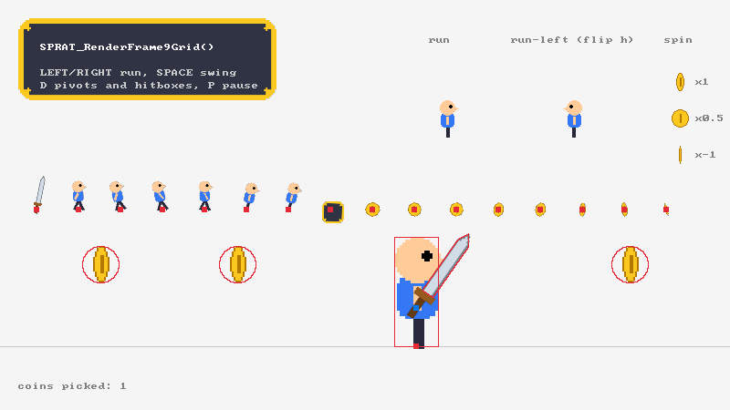

# sprat-sdl

Load and render [sprat-cli](https://github.com/pedroac/sprat-cli) sprite sheets with
[SDL3](https://libsdl.org/).

A small C99 library in the style of SDL's own satellite libraries (SDL_image,
SDL_ttf): `SPRAT_` functions that return `NULL` or `false` and set `SDL_GetError()`,
SDL types (`SDL_FRect`, `SDL_FPoint`, `SDL_FlipMode`, `SDL_IOStream`), and no
dependencies beyond SDL. It reads the metadata written by
`spratconvert --transform raw` through [sprat-lib](https://github.com/pedroac/sprat-lib),
loads the atlas textures next to it, and renders sprites the way they were
authored: placed by their pivot, with trimming and packing rotation undone.



```sh
spratlayout ./frames --trim-transparent --rotate > layout.txt
spratpack -a atlas.png < layout.txt > /dev/null
spratconvert --transform raw -a atlas.png \
    --markers markers.txt --animations animations.txt < layout.txt > hero.sprat
```

```c
#define SDL_MAIN_USE_CALLBACKS 1
#include <SDL3/SDL.h>
#include <SDL3/SDL_main.h>
#include <SDL3_sprat/SDL_sprat.h>

static SDL_Window *window;
static SDL_Renderer *renderer;
static SPRAT_Sheet *sheet;
static SPRAT_AnimationPlayer run;
static Uint64 last;

SDL_AppResult SDL_AppInit(void **appstate, int argc, char *argv[])
{
    SDL_Init(SDL_INIT_VIDEO);
    SDL_CreateWindowAndRenderer("sprat-sdl", 800, 450, 0, &window, &renderer);

    sheet = SPRAT_LoadSheet(renderer, "resources/hero.sprat");
    if (!sheet) {
        SDL_Log("Couldn't load the sheet: %s", SDL_GetError());
        return SDL_APP_FAILURE;
    }
    SPRAT_InitAnimationPlayer(&run, SPRAT_GetAnimationFromName(sheet, "run"));
    last = SDL_GetTicksNS();
    return SDL_APP_CONTINUE;
}

SDL_AppResult SDL_AppIterate(void *appstate)
{
    Uint64 now = SDL_GetTicksNS();
    SPRAT_UpdateAnimation(&run, (float)(now - last) / SDL_NS_PER_SECOND);
    last = now;

    SDL_SetRenderDrawColor(renderer, 245, 245, 245, 255);
    SDL_RenderClear(renderer);
    SPRAT_RenderAnimation(renderer, sheet, &run, 400.0f, 300.0f);
    SDL_RenderPresent(renderer);
    return SDL_APP_CONTINUE;
}

SDL_AppResult SDL_AppEvent(void *appstate, SDL_Event *event)
{
    return (event->type == SDL_EVENT_QUIT) ? SDL_APP_SUCCESS : SDL_APP_CONTINUE;
}

void SDL_AppQuit(void *appstate, SDL_AppResult result)
{
    SPRAT_DestroySheet(sheet);
}
```

## Building

sprat-sdl needs SDL 3.4 or newer and sprat-lib 0.6 or newer. With CMake,
`sprat-sdl::sprat-sdl` brings SDL3 along:

```cmake
add_subdirectory(sprat-sdl)             # or find_package(sprat-sdl) after an install
target_link_libraries(game PRIVATE sprat-sdl::sprat-sdl)
```

```c
#include <SDL3_sprat/SDL_sprat.h>
```

Without CMake, compile `src/SDL_sprat.c` with your game:

```sh
cc game.c src/SDL_sprat.c -Iinclude -I../sprat-lib/include ../sprat-lib/src/*.c $(pkg-config --cflags --libs sdl3)
```

The CMake build uses installed SDL3 and sprat packages when it finds them and
downloads them otherwise. To build against a local checkout, pass
`-DFETCHCONTENT_SOURCE_DIR_SPRAT=../sprat-lib` (or `FETCHCONTENT_SOURCE_DIR_SDL3`).

```sh
cmake -S . -B build -DBUILD_TESTING=ON
cmake --build build --parallel
ctest --test-dir build --output-on-failure
./build/bin/sprite_sheet
```

| Option | Default | Effect |
|---|---|---|
| `BUILD_SHARED_LIBS` | `OFF` | Build a shared library |
| `SPRAT_SDL_BUILD_EXAMPLES` | `ON` when top level | Build `sprite_sheet` |
| `SPRAT_SDL_SANITIZE` | `OFF` | Build with AddressSanitizer and UBSan (GCC/Clang) |
| `SPRAT_SDL_INSTALL` | `ON` with installed SDL3 and sprat | Generate install rules |

## API

```c
int SPRAT_Version(void);

/* Sheets */
SPRAT_Sheet *SPRAT_LoadSheet(SDL_Renderer *renderer, const char *file);
SPRAT_Sheet *SPRAT_LoadSheet_IO(SDL_Renderer *renderer, SDL_IOStream *src, bool closeio, const char *atlas_dir);
void SPRAT_DestroySheet(SPRAT_Sheet *sheet);

/* Frames */
int SPRAT_GetFrameFromName(const SPRAT_Sheet *sheet, const char *name);
const SPRAT_Marker *SPRAT_GetFrameMarker(const SPRAT_Sheet *sheet, int frame, const char *name);
bool SPRAT_RenderFrame(SDL_Renderer *renderer, const SPRAT_Sheet *sheet, int frame, float x, float y);
bool SPRAT_RenderFrame9Grid(SDL_Renderer *renderer, const SPRAT_Sheet *sheet, int frame, float scale, const SDL_FRect *dstrect);

/* Sprites: frames placed on the screen, and their markers */
bool SPRAT_RenderSprite(SDL_Renderer *renderer, const SPRAT_Sprite *sprite);
const SPRAT_Marker *SPRAT_GetSpriteMarker(const SPRAT_Sprite *sprite, const char *name);
bool SPRAT_GetSpritePoint(const SPRAT_Sprite *sprite, const SDL_FPoint *point, SDL_FPoint *result);
bool SPRAT_GetMarkerCenter(const SPRAT_Sprite *sprite, const SPRAT_Marker *marker, SDL_FPoint *result);
int SPRAT_GetMarkerOutline(const SPRAT_Sprite *sprite, const SPRAT_Marker *marker, SDL_FPoint *points, int max_points);
bool SPRAT_MarkersOverlap(const SPRAT_Sprite *sprite_a, const SPRAT_Marker *marker_a,
                          const SPRAT_Sprite *sprite_b, const SPRAT_Marker *marker_b);

/* Animations */
const SPRAT_Animation *SPRAT_GetAnimationFromName(const SPRAT_Sheet *sheet, const char *name);
void SPRAT_InitAnimationPlayer(SPRAT_AnimationPlayer *player, const SPRAT_Animation *animation);
void SPRAT_UpdateAnimation(SPRAT_AnimationPlayer *player, float seconds);
void SPRAT_PlayAnimation(SPRAT_AnimationPlayer *player);
void SPRAT_StopAnimation(SPRAT_AnimationPlayer *player);
void SPRAT_PauseAnimation(SPRAT_AnimationPlayer *player);
void SPRAT_ResumeAnimation(SPRAT_AnimationPlayer *player);
bool SPRAT_IsAnimationFinished(const SPRAT_AnimationPlayer *player);
int SPRAT_GetAnimationFrame(const SPRAT_AnimationPlayer *player);
bool SPRAT_RenderAnimation(SDL_Renderer *renderer, const SPRAT_Sheet *sheet, const SPRAT_AnimationPlayer *player, float x, float y);
```

Every function is documented in [`SDL_sprat.h`](include/SDL3_sprat/SDL_sprat.h),
in SDL's format.

### Errors

As in SDL, functions that can fail return `NULL`, `-1` or `false` and set the
error that `SDL_GetError()` returns, with sprat-lib's message naming the value
at fault and where it is:

```
Couldn't load sprite sheet resources/hero.sprat: 4:14: sprites[0].rect.w: expected an integer, found "4x"
```

Rendering an out-of-range frame, or a frame whose atlas isn't loaded, renders
nothing and returns `false`. Nothing is logged.

Names and paths from the sheet are escaped with sprat-lib's `sprat_escape()`
before they go into a message, so a hostile sheet can't put terminal escape
sequences or reordered text into your logs.

### The sheet

A `SPRAT_Sheet` is read-only, like an `SDL_Surface`'s fields: read its arrays
directly, and destroy it once.

```c
typedef struct SPRAT_Sheet
{
    int num_atlases;                    /* number of atlases */
    SPRAT_Atlas *atlases;               /* path, size and SDL_Texture of each atlas */
    int num_frames;                     /* number of frames */
    const SPRAT_Frame *frames;          /* the frames, in sheet order */
    int num_animations;                 /* number of animations */
    const SPRAT_Animation *animations;  /* the animations, in sheet order */
    float scale;                        /* the scale the art was packed at */
} SPRAT_Sheet;
```

- **Frames** are the sheet's sprites, in its order. A `SPRAT_Frame` keeps the
  atlas region as stored (`source`, `rotation`), the original image's size
  (`w`, `h`), the trimmed `content` region inside it, the `pivot`, the
  nine-slice insets (`slice`) and the frame's `markers`. Frame geometry is in
  original-image pixels, scaled to atlas pixels, with Y pointing down.
- **Animations** list frame indexes in play order, with an `fps` and the
  `SDL_FlipMode` they are played with. Aliases are already resolved: `run-left`,
  an alias of `run` with `flip h`, has `run`'s frames (the same array, not a
  copy) and `flip` set to `SDL_FLIP_HORIZONTAL`. An animation may have no frames.
- **Names**: a frame's `name` is its file's basename and can repeat across
  folders; its `path` is unique. `SPRAT_GetFrameFromName()` takes either: it
  matches the path first, then a name that only one frame has, and returns -1
  otherwise. Look names up once, after loading, and keep the indexes.

Frames and animations keep the order of the sprat file, so the indexes that
sprat-lib's `sprat_sheet_bind()` resolves (and its animation frame indexes)
index `sheet->frames` and `sheet->animations` as they are.

### Rendering

Every render function places a frame by its **pivot**, the point
`spratconvert` was given with a `pivot` marker (`0, 0`, the top-left of the
original image, when there was none). Trimmed margins are left out, and
frames packed turned are rendered upright. Each frame is a single
`SDL_RenderTexture()` call, or `SDL_RenderTextureRotated()` when it is turned or
flipped, with `SDL_FRect` rectangles that keep subpixel positions on hardware
renderers. The software renderer rounds a rotated rectangle to whole pixels
first, so there the same copy is given by its corners, with
`SDL_RenderTextureAffine()`, and lands where the hardware renderers put it.

`SPRAT_RenderFrame()` puts a frame's pivot at a point. To scale, mirror or
turn it, describe it with a **sprite**: a frame placed on the screen, a plain
struct you keep as part of your game's state, as you keep an `SDL_FRect`:

```c
typedef struct SPRAT_Sprite
{
    const SPRAT_Sheet *sheet;
    int frame;                  /* an index into sheet->frames */
    float x, y;                 /* where the frame's pivot is */
    float scale_x, scale_y;     /* negative to mirror */
    double angle;               /* clockwise, in degrees, around the pivot */
    SDL_FlipMode flip;          /* mirroring around the pivot */
} SPRAT_Sprite;

SPRAT_Sprite hero = { sheet, idle, 400.0f, 380.0f, 3.0f, 3.0f, 0.0, SDL_FLIP_NONE };

hero.x += speed * dt;
SPRAT_RenderSprite(renderer, &hero);
```

`SPRAT_RenderSprite()` scales the frame, mirrors it about its pivot with
`SDL_FLIP_HORIZONTAL` and/or `SDL_FLIP_VERTICAL`, then turns it clockwise
around the pivot by `angle` degrees, the same convention as
`SDL_RenderTextureRotated()`. The marker functions take the same sprite, so a
hitbox is always where its frame is drawn. Set both scales: a sprite
initialized as `{ sheet, frame, x, y }` has a scale of 0 and is not visible.
In the sheet's own records each image is called a sprite; here a sprite is one
of them placed, `sheet->frames[frame]` put on the screen.

How a frame is drawn is up to its atlas texture, as with any SDL texture: set
`SDL_SetTextureColorMod()`, `SDL_SetTextureAlphaMod()` or
`SDL_SetTextureBlendMode()` on `sheet->atlases[i].texture` to tint or fade it.
For pixel art, call `SDL_SetDefaultTextureScaleMode(renderer, SDL_SCALEMODE_PIXELART)`
(or `SDL_SCALEMODE_NEAREST`) before loading the sheet.

`scale_x` and `scale_y` are yours to choose and are not `sheet->scale`: frame
geometry is in atlas pixels, so `1.0f` renders atlas pixels one to one. For a
sheet packed at `--scale 0.5`, render at `1.0f / sheet->scale` to show the art
at its original size.

### Animations

An animation from the sheet is a template: `SPRAT_GetAnimationFromName()`
returns it by name, or `NULL` when there is none. Playing it takes a
`SPRAT_AnimationPlayer`, a plain struct you keep one of per animated thing:

```c
typedef struct SPRAT_AnimationPlayer
{
    const SPRAT_Animation *animation;   /* the animation played, NULL for none */
    float time;                         /* seconds into the animation, from 0 to num_frames / fps */
    float speed;                        /* 1.0f plays at the animation's fps, negative plays in reverse */
    bool playing;                       /* advanced by SPRAT_UpdateAnimation() */
    bool loop;                          /* wrap around at the end, otherwise stop on the last frame */
} SPRAT_AnimationPlayer;
```

`SPRAT_InitAnimationPlayer()` sets one up playing, looping, at speed `1.0f`; it
allocates nothing, so copy it or drop it freely. Call
`SPRAT_UpdateAnimation(&player, seconds)` once per frame, with the time since
the last one (a difference of `SDL_GetTicksNS()` divided by
`SDL_NS_PER_SECOND`): time only moves while you update it, so pausing the game,
slow motion or a fixed time step apply to animations too.
`SPRAT_PauseAnimation()` and `SPRAT_ResumeAnimation()` keep the time,
`SPRAT_PlayAnimation()` restarts and `SPRAT_StopAnimation()` rewinds without
playing.

A negative `speed` plays in reverse, and `SPRAT_PlayAnimation()` then starts
from the last frame. Set `loop` to `false` to play once: the player stops on the
last frame it reaches (the first when reversed) and
`SPRAT_IsAnimationFinished()` becomes true. The fields are yours to read and
set, `time` included.

`SPRAT_GetAnimationFrame()` gives the frame shown now, an index into
`sheet->frames`. `SPRAT_RenderAnimation()` renders it with the animation's
flip. To scale, turn or mirror it, or to use its markers, set a sprite's frame
from it each update, and combine the animation's flip with yours:

```c
enemy.sprite.frame = SPRAT_GetAnimationFrame(&enemy.walk);
enemy.sprite.flip = (SDL_FlipMode)(enemy.walk.animation->flip ^ enemy.facing);
SPRAT_RenderSprite(renderer, &enemy.sprite);
```

### Markers

Markers (`pivot`, hitboxes, hands, spawn points...) are in original-image
pixels: they mean something once placed with a sprite of their frame, and the
marker functions place them as `SPRAT_RenderSprite()` places the frame.
`SPRAT_GetSpriteMarker()` looks one up by name in the sprite's frame; look it up
again when the frame changes, since each frame has its own markers.

`SPRAT_GetMarkerCenter()` gives where a marker is: a point marker's point, or
the center of another shape (a polygon's centroid). Use it to attach items to
a hand, spawn things at a muzzle, or aim at a hitbox:

```c
const SPRAT_Marker *hand = SPRAT_GetSpriteMarker(&hero, "hand");
SDL_FPoint grip;

if (hand && SPRAT_GetMarkerCenter(&hero, hand, &grip)) {
    sword.x = grip.x;
    sword.y = grip.y;
    SPRAT_RenderSprite(renderer, &sword);
}
```

`SPRAT_GetMarkerOutline()` gives a marker's outline, closed, to draw with
`SDL_RenderLines()`. It fills a buffer and returns how many points the outline
has, like `snprintf()`; a circle gets up to 257 points, as many as keep it
within a quarter of a pixel of the curve:

```c
SDL_FPoint outline[257];
int count = SPRAT_GetMarkerOutline(&hero, hitbox, outline, SDL_arraysize(outline));
if (count > 0) {
    SDL_RenderLines(renderer, outline, SDL_min(count, (int)SDL_arraysize(outline)));
}
```

So the marker functions cover what a marker is used for, and its fields are
there for anything else. `SPRAT_GetSpritePoint()` places any other point of the
original image.

### Collisions

`SPRAT_MarkersOverlap()` tells whether markers of two sprites overlap, such as
two hitboxes, comparing them where the sprites are rendered:

```c
if (SPRAT_MarkersOverlap(&hero, SPRAT_GetSpriteMarker(&hero, "hitbox"),
                         &coin, SPRAT_GetSpriteMarker(&coin, "hitbox"))) {
    /* picked */
}
```

The shapes are compared exactly, whatever their types and placements: a
rectangle turns with its sprite, a circle scaled unevenly is an ellipse, and a
polygon may be concave. A point overlaps the shapes it lies in, and shapes that
only touch overlap. A marker missing from its frame (`NULL`) is an error, which
returns `false` like no overlap; check `SDL_GetError()` when it matters. The
sprites may come from different sheets, and a marker need not come from its
sprite's frame: a range the program makes, in the frame's pixels, works too.

### Nine-slices

`SPRAT_RenderFrame9Grid()` renders a frame stretched to fill `dstrect`, keeping
its slice corners unstretched, like `SDL_RenderTexture9Grid()` with the frame's
slice as the corner sizes. `scale` scales the corners as it does there
(`0.0f` keeps them at their size). `dstrect` covers the whole original image,
trimmed margins included, and the pivot plays no part. It cuts the slices in
original-image space, so it handles trimmed frames and frames packed turned,
which `SDL_RenderTexture9Grid()` cannot. Corners shrink proportionally when
`dstrect` is smaller than them, and a frame without a slice is simply
stretched.

Every fill mode is rendered as `SPRAT_SLICEMODE_STRETCH`. `slice.horizontal_mode`
and `slice.vertical_mode` say which mode the artist chose, for code that tiles
the middle itself.

### Loading

`SPRAT_LoadSheet()` reads the file with `SDL_LoadFile()` and loads each atlas
with `SDL_LoadSurface()`, which reads BMP and PNG, joining its path with the
sheet's folder (absolute paths are used as written). `SPRAT_LoadSheet_IO()`
reads the metadata from an `SDL_IOStream` and takes the folder to resolve atlas
paths against, or `NULL` to use them as written.

A sheet loads whole or not at all: when an atlas is missing, can't be read, or
isn't the size the sheet was packed for, the load fails and `SDL_GetError()`
names the file.

Pass a `NULL` renderer to load only the metadata, on any thread. Then load the
atlases yourself, for instance with SDL_image for other formats, and hand them
to the sheet, which destroys them with itself:

```c
SPRAT_Sheet *sheet = SPRAT_LoadSheet(NULL, "resources/hero.sprat");
for (int i = 0; i < sheet->num_atlases; i++) {
    char *path;
    SDL_asprintf(&path, "resources/%s", sheet->atlases[i].path);
    sheet->atlases[i].texture = IMG_LoadTexture(renderer, path);
    SDL_free(path);
}
```

Destroy sheets before the renderer their textures belong to.

### Memory

A sheet is one allocation (with `SDL_calloc()`, so `SDL_SetMemoryFunctions()`
applies), starting at the `SPRAT_Sheet` itself, and sprat-lib's parsed sheet is
freed before the loader returns. Every array and string of a sheet points into
that allocation and stays valid until `SPRAT_DestroySheet()`.

## Example

[`examples/sprite_sheet.c`](examples/sprite_sheet.c), written with SDL's main
callbacks, renders every frame of the example sheet (most of them stored turned
in the atlas), plays the `run`, `run-left` and `spin` animations, resizes a
nine-slice panel, and lets you run a hero holding a sword at its `hand` marker.
The hero, the sword and the coins are `SPRAT_Sprite`s, rendered and collided
alike.
The hero picks up the coins its `hitbox` runs into, or that the sword's `blade`
polygon cuts while it swings, with `SPRAT_MarkersOverlap()`. `D` shows pivots,
hitboxes and the blade, `P` pauses the spins.

The sheet in `examples/resources/` was packed with sprat-cli by
`make_resources.sh`, from frames drawn by `make_sources.py`.

## Tests

`tests/test_sprat_sdl.c` needs no visible window: it renders to a target
texture on an offscreen window, with a hardware renderer, and compares every
pixel with the original image placed at its pivot. That covers every packing
rotation, flip, scale (fractional too), angle and position off the pixel grid,
nine-slices, and each frame of the example sheet against the source PNG it was
packed from.

Marker overlaps are checked case by case for every pair of shapes and every
part of a placement, against a reference that samples one marker and looks the
samples up in the other through the inverse placement, and at exact thresholds:
an ellipse grown to just short of touching another marker, then just past it.

Without a hardware renderer, the test falls back to the software renderer and
checks only the renders that land on whole pixels in quarter turns. Set
`SPRAT_TEST_REQUIRE_HARDWARE=1` to fail instead, as the Linux CI job does. To
try a given renderer, set `SDL_RENDER_DRIVER` (`opengl`, `vulkan`, `gpu`,
`software`...).

## Limitations

- Normal and collision maps are not loaded. sprat-lib gives their paths if
  you need them.
- Atlas paths are used as written, so a sheet from an untrusted source could
  name any file. Load such a sheet without a renderer, check each
  `sheet->atlases[i].path` with sprat-lib's `sprat_path_is_safe()`, and load the
  atlases yourself.
- The sheet format has no loop setting yet: every player loops until you set
  `loop` to `false`.

## License

MIT. See [LICENSE](LICENSE).
