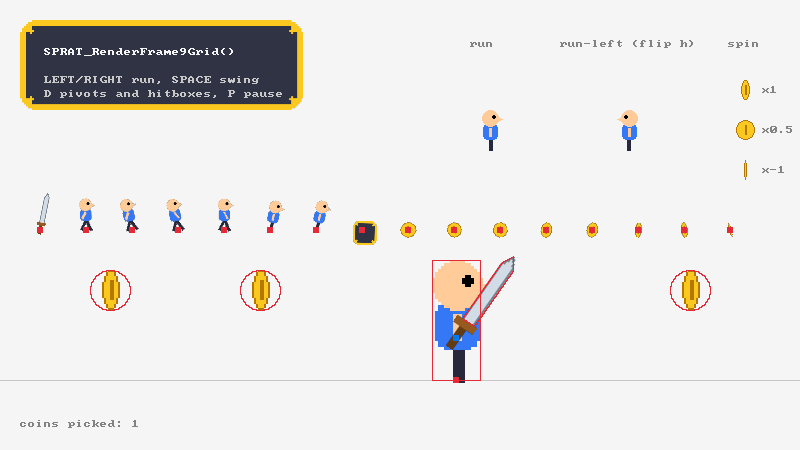

# sprat-sdl

Load and render [sprat-cli](https://github.com/pedroac/sprat-cli) sprite sheets with
[SDL3](https://libsdl.org/).

A small C99 library in the style of SDL's own satellite libraries (SDL_image,
SDL_ttf): `SPRAT_` functions that return `NULL` or `false` and set `SDL_GetError()`,
SDL types (`SDL_FRect`, `SDL_FPoint`, `SDL_FlipMode`, `SDL_IOStream`), and no
dependencies beyond SDL. It reads the metadata written by
`spratconvert --transform raw` through [sprat-lib](https://github.com/pedroac/sprat-lib),
loads the atlas textures next to it, and renders sprites the way they were
authored: placed by their pivot, with trimming and packing rotation undone.



```sh
spratlayout ./frames --trim-transparent --rotate > layout.txt
spratpack -a atlas.png < layout.txt > /dev/null
spratconvert --transform raw -a atlas.png \
    --markers markers.txt --animations animations.txt < layout.txt > hero.sprat
```

```c
#define SDL_MAIN_USE_CALLBACKS 1
#include <SDL3/SDL.h>
#include <SDL3/SDL_main.h>
#include <SDL3_sprat/SDL_sprat.h>

static SDL_Window *window;
static SDL_Renderer *renderer;
static SPRAT_Sheet *sheet;
static SPRAT_AnimationPlayer run;
static Uint64 last;

SDL_AppResult SDL_AppInit(void **appstate, int argc, char *argv[])
{
    SDL_Init(SDL_INIT_VIDEO);
    SDL_CreateWindowAndRenderer("sprat-sdl", 800, 450, 0, &window, &renderer);

    sheet = SPRAT_LoadSheet(renderer, "resources/hero.sprat");
    if (!sheet) {
        SDL_Log("Couldn't load the sheet: %s", SDL_GetError());
        return SDL_APP_FAILURE;
    }
    SPRAT_InitAnimationPlayer(&run, SPRAT_GetAnimationFromName(sheet, "run"));
    last = SDL_GetTicksNS();
    return SDL_APP_CONTINUE;
}

SDL_AppResult SDL_AppIterate(void *appstate)
{
    Uint64 now = SDL_GetTicksNS();
    SPRAT_UpdateAnimation(&run, (float)(now - last) / SDL_NS_PER_SECOND);
    last = now;

    SDL_SetRenderDrawColor(renderer, 245, 245, 245, 255);
    SDL_RenderClear(renderer);
    SPRAT_RenderAnimation(renderer, sheet, &run, 400.0f, 300.0f);
    SDL_RenderPresent(renderer);
    return SDL_APP_CONTINUE;
}

SDL_AppResult SDL_AppEvent(void *appstate, SDL_Event *event)
{
    return (event->type == SDL_EVENT_QUIT) ? SDL_APP_SUCCESS : SDL_APP_CONTINUE;
}

void SDL_AppQuit(void *appstate, SDL_AppResult result)
{
    SPRAT_DestroySheet(sheet);
}
```

## Building

sprat-sdl needs SDL 3.4 or newer and sprat-lib 0.15 or newer. With CMake,
`sprat-sdl::sprat-sdl` brings SDL3 along:

```cmake
add_subdirectory(sprat-sdl)             # or find_package(sprat-sdl) after an install
target_link_libraries(game PRIVATE sprat-sdl::sprat-sdl)
```

Without CMake, compile `src/SDL_sprat.c` with your game:

```sh
cc game.c src/SDL_sprat.c -Iinclude -I../sprat-lib/include ../sprat-lib/src/*.c $(pkg-config --cflags --libs sdl3)
```

## Documentation

The [guide](docs/guide.md) covers the build options, the full API, and how sheets,
rendering, sprites, animations, puppets, markers, collisions and nine-slices work.
Every function is documented in [`SDL_sprat.h`](include/SDL3_sprat/SDL_sprat.h).

## Example

[`examples/sprite_sheet.c`](examples/sprite_sheet.c), written with SDL's main
callbacks, renders every frame of the example sheet (most of them stored turned
in the atlas), plays the `run`, `run-left`, `spin` and `spin-pingpong`
animations, resizes a nine-slice panel, and lets you run a hero holding a sword
at its `hand` marker.
The hero, the sword and the coins are `SPRAT_Sprite`s, rendered and collided
alike.
The hero picks up the coins its `hitbox` runs into, or that the sword's `blade`
polygon cuts while it swings, with `SPRAT_MarkersOverlap()`. `D` shows pivots,
hitboxes and the blade, `P` pauses the spins.

The sheet in `examples/resources/` was packed with sprat-cli by
`make_resources.sh`, from frames drawn by `make_sources.py`.

## License

MIT. See [LICENSE](LICENSE).
